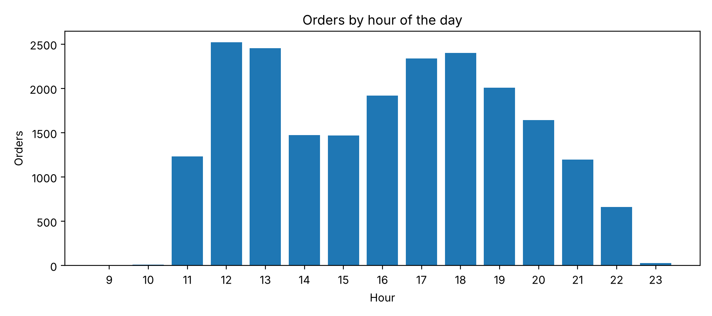
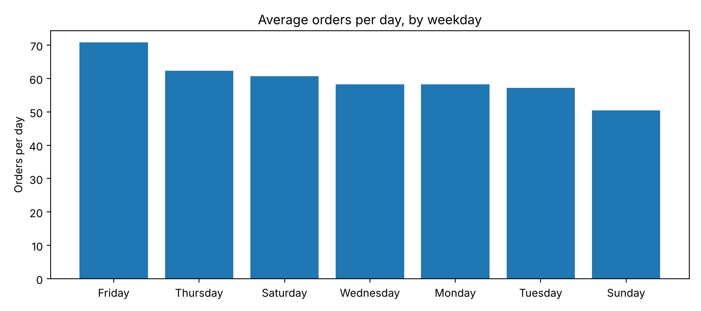

# Pizza Restaurant Sales Analysis (SQL + Python)

One year of orders from a pizza restaurant, analysed with **SQL**, with **Python (pandas, Matplotlib)** for loading the data and making charts.

## Questions
- How much do we sell, and how big is a typical order?
- When are we busiest (hour of the day, day of the week)?
- Which pizzas sell best and worst?

## Data
Pizza Place Sales (Maven Analytics data playground), Jan to Dec 2015.

| Table | Rows | What it holds |
|---|---|---|
| orders | 21,350 | date and time of each order |
| order_details | 48,620 | which pizzas are in each order, and how many |
| pizzas | 96 | size and price of each pizza |
| pizza_types | 32 | pizza name and category |

## What I did
1. Python: loaded the 4 files, checked for missing values, duplicates and IDs that don't match between tables, and added month, hour and weekday columns.
2. SQL (10 queries, see `queries.sql`): JOINs across 3 tables, GROUP BY, CTEs, subqueries, CASE, ROW_NUMBER and LAG.
3. Python: charts with Matplotlib.

## Results
- $817,860 revenue from 21,350 orders; average order $38.31 with about 2.3 pizzas.
- Busiest at lunch: 12 pm and 1 pm have 23% of all orders. Second peak 5 to 7 pm.
- Friday is the busiest day (about 71 orders a day), Sunday the quietest (about 51).
- Large pizzas bring 46% of revenue. XXL sold only 28 pizzas in the year.
- 20 of 32 pizza types sell below the average; the weakest is The Brie Carre Pizza.
- 38% of orders are a single pizza.

## Recommendations
1. More staff at lunch, 5 to 7 pm, and on Fridays.
2. Review the bottom 5 pizzas to simplify the menu.
3. Consider dropping the XXL size.
4. A combo offer to turn single-pizza orders into bigger ones.

## Files
- `pizza_sales_analysis.ipynb`: the full analysis
- `queries.sql`: all SQL queries
- the 4 data tables as CSV files
- the chart images (.png)
